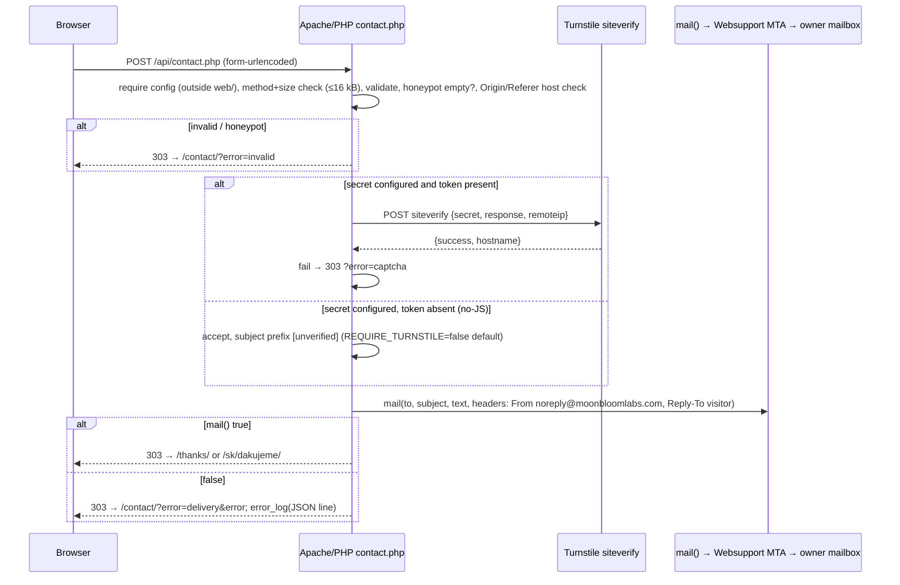

# Moonbloom Labs — Technical Architecture Plan

Status: Phase 1 plan, revised for Websupport.sk hosting and a same-day launch. Date: 2026-10-22. Owner: architect.
Companion documents: sitemap / wireframes / palette / typography (designer), `DEPLOY.md` (derived from section 12), `README.md` (placeholder inventory, 5.4).

Launch constraint: production goes live **tonight** on Websupport.sk shared hosting by manual SFTP upload from the owner's machine. Everything marked **later** is designed in but not required for tonight. Cloudflare Pages remains a future option; the repo is kept portable (section 13).

---

## 1. Goals, constraints, non-goals

Goals
- Lighthouse ≥ 95 in all categories, mobile, every page. First-party JS < 50 kB total; works fully without JS, including the contact form.
- No cookies, no consent banner, no third-party font requests. No secrets in git.

Hosting facts (given, verified against the `deploying-websupport-site` skill)
- Websupport.sk: Apache behind openresty; TLS terminates at openresty. **Never add a `%{HTTPS}` rewrite rule — it loops.** `.htaccess` is honoured; PHP available; `mail()` available.
- SFTP (`mod_sftp`) to `ftp.moonbloomlabs.com`, chrooted account home (`/` and `~` are the same directory). Docroot: `~/moonbloomlabs.com/web/`. The home itself is outside the web root, so `~/moonbloomlabs.com/config.php` is not web-reachable.
- Websupport's placeholder `web/index.php` beats `index.html` and must be backed up and removed at deploy.
- Node 22 + npm locally; no bun, no wrangler.

Non-goals: CMS, blog, SSR, auth, A/B tests, cookie consent, Accept-Language auto-redirect, Pages Functions.

---

## 2. Stack and versions

Pin exact versions (no `^`), commit `package-lock.json`; the developer resolves the latest patch of each line with `npm view` at scaffold time.

| Area | Package | Line | Why |
|---|---|---|---|
| Runtime | Node 22 LTS (`.nvmrc`) | 22 | GH runner default |
| Framework | `astro` | 5.x | Static output, built-in i18n, content collections, `astro:assets` |
| Types | `@astrojs/check`, `typescript` | 0.9.x / 5.x | `astro check` |
| Styling | `tailwindcss`, `@tailwindcss/vite` | 4.x | CSS-first tokens in `global.css` `@theme {}`; official Astro 5 path |
| Sitemap | `@astrojs/sitemap` | 3.x | Used without its `i18n` option (6.3) |
| Fonts | `@fontsource-variable/<family>` | latest | Self-hosted woff2 bundled by Vite; **must include `latin-ext`** for Slovak |
| Server | PHP on Websupport | ≥ 8.1 (select in admin) | `web/api/contact.php`, `mail()` |
| Lint/format | `eslint` 9 flat + `typescript-eslint` 8 + `eslint-plugin-astro` 1; `prettier` 3 + `prettier-plugin-astro` + `prettier-plugin-tailwindcss` | | Only toolchain that covers `.astro` templates (Biome does frontmatter only — reversible later) |
| Tests | `vitest` 3 (i18n parity, schema builders); `@playwright/test` 1.5x + `@axe-core/playwright` 4.10 (smoke, a11y); plain PHP assert script for the handler (`php tests/php/*.php`) | | No PHPUnit: one handler, keep it light |
| Lighthouse | `@lhci/cli` 0.15 | | Budgets + category assertions |
| Links | `lycheeverse/lychee-action` 2 | | Built HTML, offline for internal |

---

## 3. Repository layout

```
moonbloomlabs.com/
├── .github/workflows/ci.yml          # lint, typecheck, unit, build, links, e2e+axe, lighthouse (+ deploy job, later)
├── .github/workflows/todo-report.yml # lists [TODO: ...] in the PR summary
├── .nvmrc  .editorconfig  .gitignore  .prettierrc.json  eslint.config.js
├── astro.config.ts  tsconfig.json  lighthouserc.json  budgets.json  lychee.toml  playwright.config.ts  vitest.config.ts
├── package.json  package-lock.json  README.md  DEPLOY.md
├── deploy/
│   ├── config.example.php            # names + comments only; real file lives at ~/moonbloomlabs.com/config.php on the host
│   └── sftp-upload.sh                # later: used by CI and by the owner (netrc from pass, never args)
├── docs/plan/architecture.md  docs/design/  docs/architecture/decisions/
├── public/                           # copied verbatim into dist/ → web/
│   ├── .htaccess                     # section 8
│   ├── api/
│   │   ├── contact.php               # POST handler (thin)
│   │   └── lib/                      # functions-only PHP, each file starts with `defined('MBL') || exit;`
│   │       ├── validate.php  turnstile.php  mailer.php  respond.php
│   ├── robots.txt  favicon.svg  favicon.ico  apple-touch-icon.png  site.webmanifest
│   └── og/default.png                # the one OG image for launch (designer); per-page generation is "later"
├── src/
│   ├── config/site.ts                # siteUrl, org, contact email (public), CWA token, all with [TODO] defaults
│   ├── content.config.ts             # collections: services, legal, pages
│   ├── content/{services,legal,pages}/{en,sk}/*.md
│   ├── i18n/{locales,dictionary,en,sk,routes,index}.ts
│   ├── layouts/Base.astro  layouts/Service.astro
│   ├── components/{seo/Head.astro, seo/JsonLd.astro, nav/*, contact/ContactForm.astro, ui/*}
│   ├── scripts/contact-form.ts       # the only client JS: lazy Turnstile loader + ?error message (≈1–2 kB)
│   ├── styles/global.css             # @import "tailwindcss"; @theme tokens; fonts; reduced-motion
│   ├── assets/
│   ├── lib/schema-org.ts
│   └── pages/  (EN at root, SK under sk/ with localized slugs — see 4.1; thanks pages: /thanks/, /sk/dakujeme/)
└── tests/{unit,e2e,php}/
```

`dist/` is the exact content of the remote `web/` directory. PHP lives in `public/` so Astro copies it untouched; it is never processed by Vite.

---

## 4. Internationalisation

### 4.1 URLs — decision: EN at root, SK prefixed with localized slugs

`/`, `/services/`, `/services/rag-ai-search/`, `/about/`, `/contact/`, `/thanks/`, `/privacy-policy/`, `/imprint/`
`/sk/`, `/sk/sluzby/`, `/sk/sluzby/rag-a-ai-vyhladavanie/`, `/sk/o-nas/`, `/sk/kontakt/`, `/sk/dakujeme/`, `/sk/ochrana-sukromia/`, `/sk/impressum/`

Trailing slash always (`trailingSlash: 'always'`, `build.format: 'directory'`); Apache `mod_dir` 301s `/x` → `/x/`. Localized SK slugs cost one route map and one parity test and buy Slovak keyword paths on the SEO-relevant pages.

```ts
i18n: { defaultLocale: 'en', locales: ['en', 'sk'], routing: { prefixDefaultLocale: false, redirectToDefaultLocale: false } }
```

### 4.2 Content storage — decision

| Content | Storage |
|---|---|
| UI strings (nav, form labels, errors, footer, 404) | typed dictionaries `src/i18n/en.ts`, `sk.ts` (`satisfies Dictionary`) |
| Services (6 × 2), legal (2 × 2), home/about sections | content collections, markdown + zod frontmatter, `translationKey` per entry |

### 4.3 Cross-locale linking

`src/i18n/routes.ts` maps fixed pages (`home, services, about, contact, thanks, privacy, imprint`) to `{ en, sk }` paths; collection entries are paired by `translationKey`. `alternateFor(locale, page)` feeds the language switcher (same page in the other language), `<link rel="alternate" hreflang>` (`en`, `sk`, `x-default` = EN), and the sitemap filter.

### 4.4 Enforced by tests

Unit: identical dictionary key sets; every `translationKey` and every route exists in both locales. E2E: every URL's switcher target is 200 and points back.

---

## 5. Content model

- `services`: `translationKey` (enum of 6), `locale`, `title ≤70`, `summary ≤160` (= meta description), `heroClaim`, `icon`, `order`, `outcomes[≥3]`, `process[]?`, `faq[]?`, `caseStudy?`, `draft`. Body = long description.
- `legal`: `translationKey` (`privacy|imprint`), `locale`, `title`, `updatedAt`, `summary`.
- `pages`: `translationKey` (`home|about`), `locale`, `title`, `description`, `hero{eyebrow,headline,sub,ctaLabel}`, `sections[{id,heading,body}]`.

### 5.4 Placeholders

Marker is the literal `[TODO: <what>]` in `src/content/**`, `src/i18n/*.ts`, `src/config/site.ts`, `deploy/config.example.php`, `DEPLOY.md`. `npm run todos` (`scripts/check-todos.mjs`) prints a table; `--readme` rewrites the README section between `<!-- todos:start/end -->`; `TODO_STRICT=1` exits 1. CI job `todo-report` posts the list in the PR summary (non-blocking; owner flips strict after the placeholders are filled — tonight's launch ships with placeholders by design). Day-one placeholders: contact email, Cloudflare Web Analytics token, imprint legal details, case study per service, founder photo.

---

## 6. SEO

- `Head.astro`: title `{page} · Moonbloom Labs`, description, canonical (absolute, trailing slash, from `siteUrl`), hreflang trio, OG/Twitter (`og:image` = `/og/default.png` for launch), `og:locale` `en_US`/`sk_SK`; `noindex` on thanks and 404.
- 404: one bilingual `404.astro` → `dist/404.html`; `.htaccess` `ErrorDocument 404 /404.html`.
- Sitemap: `@astrojs/sitemap` **without** `i18n` (its alternates assume identical paths; hreflang in `<head>` is sufficient). Filter out thanks/404. `robots.txt` static with `Sitemap: https://moonbloomlabs.com/sitemap-index.xml`.
- OG images: launch with one static image; **later** build-time per-page PNGs via `satori` + `@resvg/resvg-js` endpoint (`src/pages/og/[...path].png.ts`).
- JSON-LD (`src/lib/schema-org.ts`): `Organization` (`@id #org`) everywhere; `WebSite` on home; `Service` + `BreadcrumbList` (+ `FAQPage` when `faq`) on service pages; `ContactPage`; legal `WebPage` with `dateModified`. Data blocks are not subject to `script-src`.

---

## 7. Contact form

### 7.1 Pieces

- Static form on `/contact/` and `/sk/kontakt/`: `<form method="post" action="/api/contact.php">` with `name`, `email`, `company?`, `message` (20–4000), `language` (`en|sk`, default = page locale), hidden `locale`, hidden honeypot `website` (visually hidden, `tabindex=-1`, `autocomplete=off`, not `display:none`), Turnstile container `<div class="cf-turnstile" data-sitekey=…>` rendered only when a site key is configured, and "Book a call" = `mailto:<contact>?subject=<urlencoded "Book a call – Moonbloom Labs">` (localized subject).
- `public/api/contact.php`: POST only (405 otherwise); loads config; validates; honeypot; Turnstile verify **only if** `TURNSTILE_SECRET` is non-empty in config; `mail()`; 303.
- `src/scripts/contact-form.ts` (optional enhancement, ~1–2 kB): injects `challenges.cloudflare.com/turnstile/v0/api.js` on first `focusin`/`pointerdown` inside the form (keeps Turnstile's weight off LCP and off pages where the visitor never touches the form); reads `?error=` and fills the error box with the localized message. No fetch-submit for launch: plain POST + redirect is the whole contract.

### 7.2 Sequence



### 7.3 Rules

- Redirect targets are whitelisted from the `locale` field (`en` → `/contact/`, `/thanks/`; `sk` → `/sk/kontakt/`, `/sk/dakujeme/`); never built from user input. `#error` fragment makes a CSS `:target` generic error block visible without JS; the JS enhancement upgrades it to the specific message from `?error=<invalid|captcha|delivery|method>`.
- Header injection: `name`/`company` stripped of `\r\n` and control chars, length-capped (100); `email` validated with `filter_var(FILTER_VALIDATE_EMAIL)`; visitor address goes only to `Reply-To`; `From` is fixed from config and on the domain. Body is plain text, UTF-8 (`Content-Type: text/plain; charset=UTF-8`), subject MIME-encoded.
- Body never logged; one `error_log()` JSON line per request: `{event, outcome, reason, turnstile: verified|absent|failed|disabled, locale}`.
- Rate limiting (optional, cheap): `flock`-protected per-IP counter files in `~/moonbloomlabs.com/tmp/` (outside web), 5 submissions / 10 min, else `?error=rate`. Ship if time permits; honeypot alone is acceptable for tonight.
- Portability: `lib/validate.php` holds all rules in one place; the future Pages Function (13) reimplements the same table.

### 7.4 Config file (outside the web root)

`contact.php` resolves config as `dirname(__DIR__, 2) . '/config.php'` (= `~/moonbloomlabs.com/config.php`, sibling of `web/`) and falls back to `dirname(__DIR__, 3) . '/config.php'` (= `~/config.php`). Because the SFTP account is chrooted, the owner uploads it to `/moonbloomlabs.com/config.php` as seen over SFTP; the PHP process sees the real filesystem path, which is why the code uses `__DIR__`-relative resolution instead of an absolute path. Missing config → 503 and a log line, never a crash with a stack trace (`display_errors` off via `.htaccess` `php_flag` if permitted, else `ini_set` at top of the handler).

`deploy/config.example.php` (committed; the real file is never in git and `config.php` is in `.gitignore`):

```php
<?php
return [
  'CONTACT_TO'        => '[TODO: contact email]',
  'CONTACT_FROM'      => 'noreply@moonbloomlabs.com',
  'ALLOWED_HOSTS'     => ['moonbloomlabs.com', 'www.moonbloomlabs.com'],
  'TURNSTILE_SECRET'  => '',      // empty = Turnstile verification disabled
  'REQUIRE_TURNSTILE' => false,   // true = reject submissions without a token (breaks no-JS)
  'RATE_LIMIT_DIR'    => __DIR__ . '/tmp',
];
```

Build-time public values (in `src/config/site.ts`, overridable via `PUBLIC_*` env in CI): `PUBLIC_SITE_URL`, `PUBLIC_TURNSTILE_SITE_KEY` (empty = no widget), `PUBLIC_CF_ANALYTICS_TOKEN` (empty = no beacon), `PUBLIC_DEPLOY_ENV`.

Email delivery: `mail()` through Websupport's MTA is the launch choice — zero vendors, zero keys. Deliverability depends on SPF/DKIM for the domain being set in the Websupport admin (12). If messages land in spam or `mail()` proves unreliable, **later** swap `lib/mailer.php` to Resend's REST API (EU region) with the key in `config.php`; the adapter boundary is already there.

---

## 8. `.htaccess` (security headers, redirects, hardening)

Upload `.htaccess` last, check `/` immediately, delete it on any 5xx (skill rule). Every module use is guarded by `<IfModule>` so a missing module degrades to "no header" rather than a 500.

```apache
# --- redirects (host-based only; TLS ends at openresty, never test %{HTTPS}) ---
<IfModule mod_rewrite.c>
  RewriteEngine On
  # www -> apex (safe: host match only)
  RewriteCond %{HTTP_HOST} ^www\.moonbloomlabs\.com$ [NC]
  RewriteRule ^ https://moonbloomlabs.com%{REQUEST_URI} [R=301,L]
  # http -> https ONLY if openresty forwards the proto header; absent header = rule never fires = no loop
  RewriteCond %{HTTP:X-Forwarded-Proto} =http
  RewriteRule ^ https://moonbloomlabs.com%{REQUEST_URI} [R=301,L]
</IfModule>

# --- headers ---
<IfModule mod_headers.c>
  Header always set Content-Security-Policy "default-src 'none'; base-uri 'self'; form-action 'self'; frame-ancestors 'none'; script-src 'self' https://challenges.cloudflare.com https://static.cloudflareinsights.com; style-src 'self'; img-src 'self' data:; font-src 'self'; connect-src 'self' https://cloudflareinsights.com; frame-src https://challenges.cloudflare.com; manifest-src 'self'; object-src 'none'; upgrade-insecure-requests"
  Header always set Strict-Transport-Security "max-age=31536000; includeSubDomains"
  Header always set X-Content-Type-Options "nosniff"
  Header always set Referrer-Policy "strict-origin-when-cross-origin"
  Header always set Permissions-Policy "camera=(), microphone=(), geolocation=(), payment=(), usb=(), browsing-topics=()"
  Header always set X-Frame-Options "DENY"
  Header always set Cross-Origin-Opener-Policy "same-origin"
  <FilesMatch "\.(css|js|woff2|avif|webp|png|svg|ico)$">
    Header set Cache-Control "public, max-age=31536000, immutable"
  </FilesMatch>
  <FilesMatch "\.html$">
    Header set Cache-Control "public, max-age=0, must-revalidate"
  </FilesMatch>
</IfModule>

# --- hardening ---
Options -Indexes
ErrorDocument 404 /404.html
<FilesMatch "^(config(\.example)?\.php|\.env.*|.*\.md)$">
  Require all denied
</FilesMatch>
<IfModule mod_php.c>
  php_flag display_errors Off
</IfModule>
```

CSP notes: no `'unsafe-inline'` anywhere. Astro config: `vite.build.assetsInlineLimit: 0` (scripts always external, hashed), `build.inlineStylesheets: 'never'`, no `<ClientRouter />`, no `style=""` attributes in components; an e2e test asserts zero inline `<script>`/`style=` in `dist/`. `upgrade-insecure-requests` plus HSTS cover the http→https case even if openresty does not forward the proto header. HSTS `preload` is deferred until the owner confirms (14). Whether `Header` and the proto redirect actually take effect is verified with `curl -sI` right after upload (12); if `X-Forwarded-Proto` is not forwarded, the http→https redirect is a Websupport admin setting ("force HTTPS") and is listed as a manual step. Cache-Control for immutable assets relies on Astro's hashed filenames under `/_astro/`; `.htaccess` must not match `*.php`.

---

## 9. CI/CD

### 9.1 `.github/workflows/ci.yml` — on `pull_request` and `push` to `main`

Actions pinned by SHA, `permissions: contents: read`, concurrency per ref.

| Job | Steps | Blocking |
|---|---|---|
| `lint` | `npm ci`, `prettier --check .`, `eslint .`, `php -l` on every `public/api/**/*.php` (PHP is preinstalled on `ubuntu-latest`) | yes |
| `typecheck` | `astro check` | yes |
| `unit` | `vitest run` (i18n parity, schema-org, todos script); `php tests/php/run.php` (validate/respond functions with fixture inputs, Turnstile and mailer stubbed via injected callables) | yes |
| `build` | `astro build` with `PUBLIC_DEPLOY_ENV`, `PUBLIC_*` from repo vars; upload `dist/` artifact | yes |
| `links` | lychee over `dist/**/*.html`; internal offline strict, external advisory (`continue-on-error`), `mailto:` and `[TODO` excluded | internal yes |
| `e2e` | Playwright against `php -S 127.0.0.1:8080 -t dist` (serves the static site **and** executes `api/contact.php`, with a test `config.php` placed at `dist/../config.php` and `MBL_MAILER=log` env so no mail is sent): smoke every sitemap URL, hreflang symmetry, switcher round-trip, no-JS form → 303 → thanks, honeypot → `?error=invalid`, zero inline script/style, axe WCAG 2.1 AA on every page both locales | yes |
| `lighthouse` | `lhci autorun` against the same static server, mobile, 3 runs, categories ≥ 0.95, `budgets.json` (10) | yes |
| `deploy` (**later**) | `push` to `main` only, `needs:` all above; `deploy/sftp-upload.sh` builds a 0600 netrc from `secrets.WEBSUPPORT_SFTP_USER`/`WEBSUPPORT_SFTP_PASSWORD`, pins host key from `secrets.WEBSUPPORT_SSH_KNOWN_HOSTS`, uploads `dist/` to `/moonbloomlabs.com/web/` with `lftp mirror -R --delete --exclude-glob api/lib/tmp*` (or batched `curl -T` pairs), uploads `.htaccess` last, then verifies `https://moonbloomlabs.com/` title and `curl -sI` headers; never touches `config.php`; a verification failure restores the previous `.htaccess` | yes |

Note: `.htaccess` headers are not exercised by `php -S`; the header check is part of the post-deploy verification, not CI.

### 9.2 `todo-report.yml` — PR summary of placeholders, non-blocking (5.4).

### 9.3 Renovate (`renovate.json`): weekly grouped PRs, SHA-pinned actions, lockfile maintenance; every update passes the full gate. Dependabot is the fallback.

### 9.4 Branch protection (manual): `main` requires PR + checks `lint, typecheck, unit, build, links, e2e, lighthouse`; no force push. Tonight the owner may push the initial commit directly before enabling it.

---

## 10. Performance budget (`budgets.json`, asserted by LHCI)

| Resource (compressed) | Budget |
|---|---|
| First-party JS, site-wide total | ≤ 15 kB typical, **50 kB hard** |
| Third-party JS | CWA beacon ~6 kB (only when token set); Turnstile only on the contact page, lazy on first interaction |
| CSS | ≤ 25 kB |
| Fonts | 1 variable family, `latin`+`latin-ext`, ≤ 120 kB, `font-display: swap`, preload the main face |
| HTML | ≤ 40 kB |
| Images | hero ≤ 150 kB AVIF/WebP via `astro:assets`, explicit dimensions, `fetchpriority="high"` on hero, lazy below the fold |
| Page weight / requests | ≤ 500 kB / ≤ 25 |

Metrics: LCP ≤ 2.0 s, CLS ≤ 0.05, TBT ≤ 100 ms (mobile lab). No framework runtime; CSS-only interactions (`:has()`, `<details>`); `prefers-reduced-motion: reduce` kills transitions/animations globally, content never depends on animation to become visible. Note: Websupport has no edge CDN and (verify) may not serve Brotli — gzip via `mod_deflate` is enabled in `.htaccess` if the module exists (`AddOutputFilterByType DEFLATE text/html text/css application/javascript image/svg+xml`).

---

## 11. Analytics — decision: Cloudflare Web Analytics beacon (works on any host)

Free, no cookies, no consent needed, includes RUM Web Vitals. Manual `<script defer src="https://static.cloudflareinsights.com/beacon.min.js" data-cf-beacon='{"token":"…"}'>` in `Base.astro`, rendered **only** when `PUBLIC_CF_ANALYTICS_TOKEN` is non-empty (launch ships without it; token is a manual step, 12). CSP already allows it. Plausible remains the swap if goals/funnels are wanted (one line).

---

## 12. Manual steps for the owner (feeds `DEPLOY.md`)

Tonight (manual SFTP, per the `deploying-websupport-site` skill — netrc from `pass`, never a password on a command line or in chat; ≤ 6 login attempts):
1. Websupport admin: confirm `moonbloomlabs.com` and `www` are attached to this hosting account with docroot `web/`; select PHP ≥ 8.1. Evidence: `curl -s https://moonbloomlabs.com/ | grep -o '<title>[^<]*'` currently shows the Websupport placeholder.
2. Build locally: `npm ci && npm run build` (CI green on the PR first if time allows).
3. SFTP: list `/`, back up `web/index.php` to the scratch dir, delete it. Upload `dist/*` into `/moonbloomlabs.com/web/` (batched in one curl session), **`.htaccess` last**.
4. Upload `config.php` (from `deploy/config.example.php`, with the real recipient) to `/moonbloomlabs.com/config.php`; create `/moonbloomlabs.com/tmp/` if rate limiting is enabled. Evidence: `curl -sI https://moonbloomlabs.com/config.php` is 404/403, and a POST with a filled honeypot redirects to `?error=invalid`.
5. Verify: apex and `www` status + `<title>`, `www` → apex 301, `http://` → `https://` (if not, enable "force HTTPS" in the Websupport admin — it is the fallback for the proto-header rule), `curl -sI` shows the CSP/HSTS headers (if a 5xx appears, delete `.htaccess` and bisect), submit the form for real and receive the email.
6. Email: set SPF for the domain to include Websupport's sender (`v=spf1 include:<websupport spf include from admin> ~all`) and enable DKIM if the panel offers it; DMARC `v=DMARC1; p=none; rua=mailto:<contact>` to start. Evidence: test mail passes SPF in the received headers.

Soon after:
7. Cloudflare Turnstile widget (works regardless of hosting): site key → repo var `PUBLIC_TURNSTILE_SITE_KEY`; secret → `config.php` `TURNSTILE_SECRET` (upload the file again). Evidence: widget renders; a bad token yields `?error=captcha`.
8. Cloudflare Web Analytics site → token → repo var `PUBLIC_CF_ANALYTICS_TOKEN`; rebuild + redeploy. Evidence: pageviews appear, none from local runs.
9. GitHub: branch protection (9.4); repo vars `PUBLIC_SITE_URL`, `PUBLIC_TURNSTILE_SITE_KEY`, `PUBLIC_CF_ANALYTICS_TOKEN`, later `TODO_STRICT=1`; Renovate app.
10. CI deploy (**later**): GitHub secrets `WEBSUPPORT_SFTP_USER`, `WEBSUPPORT_SFTP_PASSWORD`, `WEBSUPPORT_SSH_KNOWN_HOSTS` (output of `ssh-keyscan -p 22 ftp.moonbloomlabs.com`); consider a dedicated SFTP sub-account limited to `web/` if Websupport supports it.
11. Content/legal: contact email, imprint legal entity data (name, seat, IČO, VAT, register), privacy inputs (controller, Websupport and Cloudflare as processors, retention of form emails), photos with licence, case studies. Each is a `[TODO]`.
12. Google Search Console (DNS TXT), submit sitemap; decide HSTS `preload`.

---

## 13. Portability to Cloudflare Pages (future option)

Kept deliberately cheap: static `dist/` is host-agnostic; `.htaccess` headers map 1:1 to a `_headers` file (same strings) and the two redirects to a Cloudflare redirect rule; `public/api/contact.php` + `lib/validate.php` map to `functions/api/contact.ts` with the same field names, redirect contract (`303 → /thanks/`, `?error=<code>#error`) and config keys as env vars; mailer swaps from `mail()` to Resend/Workers fetch. Do not introduce PHP anywhere except `public/api/`.

---

## 14. Open technical questions for the owner

1. Recipient address for `CONTACT_TO` and the `From` address (`noreply@moonbloomlabs.com` proposed) — does the Websupport mailbox/SPF cover it?
2. Does Websupport's openresty forward `X-Forwarded-Proto`? If unknown, the http→https redirect is the admin "force HTTPS" toggle; the `.htaccess` rule is harmless either way.
3. Accept the no-JS policy: submissions without a Turnstile token are delivered with an `[unverified]` subject prefix (`REQUIRE_TURNSTILE=false`)? Flipping it breaks the no-JS form.
4. Localized SK slugs (`/sk/sluzby/...`) — confirm before the designer finalises the sitemap.
5. Ship the optional file-based rate limiter tonight, or honeypot only?
6. HSTS `preload`: commit to HTTPS-only on every current and future subdomain?
7. Imprint jurisdiction (SK company → Slovak + GDPR wording) and whether a supervisory-authority line is required.
8. Typeface must exist as self-hostable woff2 with `latin-ext`; commercial fonts need a web self-hosting licence and go in `src/assets/fonts/`.
9. Is PHP `mail()` acceptable for launch given spam-folder risk, or should Resend be wired before go-live?

---

## 15. Implementation roadmap

| Phase | Work | Agent | Acceptance |
|---|---|---|---|
| 0 (tonight) | Scaffold (sections 2–3), i18n helpers + parity test, `Base.astro`, `.htaccess`, `robots.txt`, `404`, CI workflow | developer | `npm run build` green; CI jobs defined |
| 1 (tonight) | All pages EN+SK from the designer's sitemap/wireframes with `[TODO]` copy, fonts, SEO head, JSON-LD, sitemap, default OG | frontend-dev | Lighthouse ≥ 95 locally; axe clean; parity + smoke pass |
| 2 (tonight) | `contact.php` + `lib/*` (test script first), form component, thanks pages, `?error` handling, CSS `:target` block, lazy Turnstile loader | developer + frontend-dev | PHP tests green; no-JS e2e green |
| 3 (tonight) | `DEPLOY.md` from section 12, README placeholder inventory | documenter | Owner runs it top to bottom |
| 4 (tonight) | Manual SFTP deploy + verification | owner (+ devops using the Websupport skill) | Public URL serves the site title, headers present, email received |
| 5 (later) | CI SFTP deploy job, Turnstile + analytics tokens, per-page OG generation, rate limiter, Renovate, `TODO_STRICT` | developer / devops | Push to `main` deploys and verifies without manual steps |

Frozen contracts between agents: form field names and redirect codes (7.1, 7.3), the `Dictionary` type and `routes` map (4.3), `config.php` keys (7.4).
